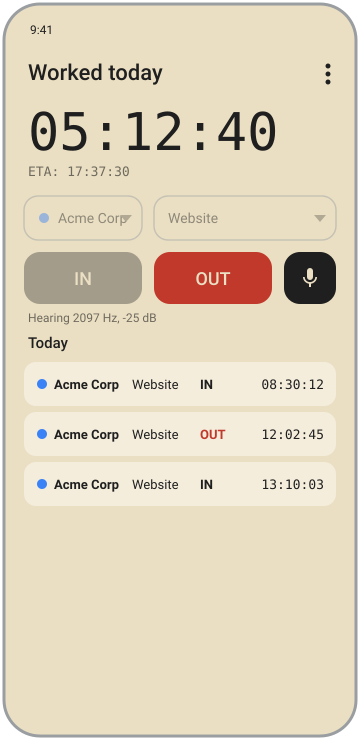
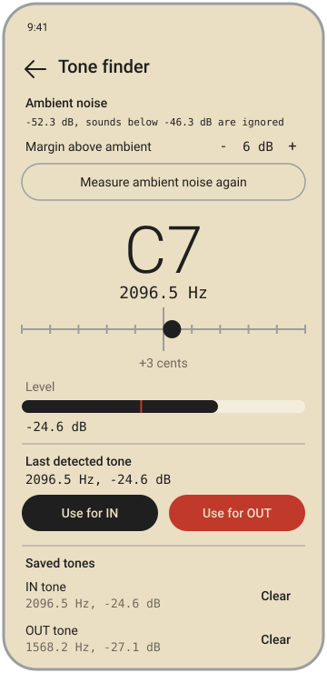
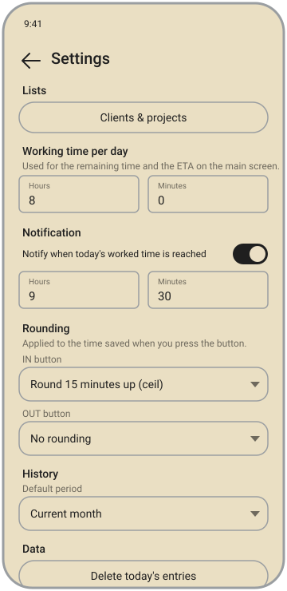

# Work Hours

A simple, minimalist Android app to track your work hours. Press **IN** and **OUT**, pick the client and project you work on, and see your worked time live. Everything is stored locally on the phone: no account, no sync.

Requires Android 8.0 (API 26) or newer.

## Download

Get the APK of the official releases from the [Releases page](https://github.com/mircopergreffi/worktracker/releases).

## Screenshots

<table>
  <tr>
    <td align="center"> Main screen, clocked in</td>
    <td align="center"> Dark theme</td>
    <td align="center"> Listening for tones</td>
  </tr>
  <tr>
    <td align="center"> History with filters</td>
    <td align="center"> Day screen, session through midnight</td>
    <td align="center"> Edit an entry</td>
  </tr>
  <tr>
    <td align="center"> Tone finder</td>
    <td align="center"> Settings</td>
    <td></td>
  </tr>
</table>

> The images are illustrations of the screens, not real screenshots.

## Contents

- [Quick start](#quick-start)
- [Main screen](#main-screen)
- [Working through midnight](#working-through-midnight)
- [Rounding](#rounding)
- [Tone trigger](#tone-trigger)
- [Menu](#menu)
- [History](#history)
- [Day screen](#day-screen)
- [Editing and deleting entries](#editing-and-deleting-entries)
- [Notification](#notification)
- [Settings](#settings)
- [Data](#data)
- [Permissions](#permissions)
- [License](#license)

## Quick start

1. Open **Settings** from the menu (three dots) and set your **working time per day** (default 8 hours).
2. On the main screen, pick a client and a project. If you have none yet, create them directly from the dropdowns.
3. Press **IN** when you start working and **OUT** when you stop.
4. Open **History** from the menu to see your hours over a period.

## Main screen

- **Live counter** of today's time in `HH:MM:SS`.
- **ETA** below the counter: the time of day when you reach your working time per day. It shows `(+1)` if that is after midnight.
- **Worked or remaining time.** Tap the counter or the title to switch. The title tells you what the counter shows: "Worked today", "Remaining today" or "Overtime today".
- **Client and project selectors.**
  - Only the projects of the chosen client are listed.
  - You can create a new client (with a color) or project directly from the dropdowns.
  - Both are required to press IN. OUT uses the client and project of the IN.
  - While you are clocked in they are grayed out and show the running entry's client and project.
- **IN and OUT buttons.** Each press saves an entry with the current time (see [Rounding](#rounding)). IN is enabled while you are clocked out, OUT while you are clocked in.
- **Microphone button** next to OUT: starts and stops listening for tones (see [Tone trigger](#tone-trigger)).
- **Today's entries**, each with its client (and color), project, IN/OUT and time. Tap an entry to edit or delete it.

## Working through midnight

- An OUT after midnight is saved on the **day of the IN**, with hours 24 and up (01:30 is stored as `25:30:00` and shown as `01:30:00 +1`). One shift stays one IN/OUT pair on one day.
- While such a session is running, the main screen keeps showing it: the title says "(since yesterday)", for example "Worked (since yesterday)", and the list is headed "Yesterday".
- An IN left open for more than a day is not counted as running.

## Rounding

The IN and OUT buttons each have their own setting: no rounding, minutes up / down / nearest, 15 minutes up / down, 30 minutes up / down, 1 hour up / down.

- A rounded time is never earlier than the previous entry.
- Rounding never moves an IN into the next day (it stops at 23:59:59).

## Tone trigger

Press IN or OUT with a sound (a whistle, a beep, a note), hands free. It only works while the app is open and listening is switched on.

### Set up the tones

1. Open **Tone finder** from the menu. The first time, it listens for 5 seconds to measure the ambient noise: keep quiet.
2. Make the sound you want to use for IN. It appears under **Last detected tone**; tap **Use for IN**.
3. Do the same for OUT with **Use for OUT**. The two tones can be different or the same sound.
4. Back on the main screen, tap the **microphone button** to start listening. It is filled while listening and shows the frequency and level it hears. Tap it again to stop.

When the app hears the IN tone it presses IN, and when it hears the OUT tone it presses OUT, as if you had tapped the button (with the same rounding, client and project rules).

### Tone finder

A screen that works like a guitar tuner.

- **Note and frequency:** the nearest note (for example `C7`) and the frequency in Hz.
- **Cents gauge:** the needle is in the middle when the tone is exactly on the note, with ticks every 10 cents. The offset is shown below it (for example `+3 cents`).
- **Level meter:** from -80 dB (left) to 0 dB (right). The red mark is the ignore threshold.
- **Ambient noise:** sounds quieter than the ambient level plus a **margin** (default 6 dB, adjust with - and +) are ignored, here and when listening on the main screen. The measured level is kept; tap **Measure ambient noise again** if you move to a different place.
- **Saved tones:** the IN and OUT tones with their frequency and level. Each can be cleared.
- The screen stays on while the Tone finder is open, and tones never press IN or OUT from here.

### How matching works

- While you are clocked out only the IN tone is listened for, and while you are clocked in only the OUT tone. This is why both can be the same sound.
- A tone matches when its frequency is within 3% of the saved one (at least 15 Hz), it is at most 8 dB quieter than the saved level, and it lasts 0.3 seconds.
- After a trigger there is a 4 second pause.
- IN still needs a selected client and project.
- The screen stays on while listening. The microphone stops when the app leaves the foreground and starts again when you come back.
- If no tone is saved yet, the microphone button tells you to save one first in the Tone finder.

## Menu

The three dots in the top right corner.

- **Dark / light theme.** Light is the default and uses the colors of the app icon (beige dial, black, red, steel). Dark is modelled on a black pilot-watch dial (matte black with cream details and a red accent). The choice is remembered.
- **History**
- **Tone finder**
- **Export database (txt)**: saves all entries as a text file with the system file picker. One line per entry: `id;day;in_out;time;client_id;project_id;client;project`.
- **Settings**

## History

- **Period:** last 30 days, current week, last week, current month, last month. Weeks start on your locale's first day of the week; "current" periods end today. The default period is set in Settings.
- **Filters:** client and/or project (choosing a project also selects its client).
- **Hide empty days** switch.
- **Total hours** for the period, and one row per day with a bar and the hours worked.
- **Open a day** by tapping it in the list, or with **Pick a day** from a calendar.

## Day screen

- The worked time of the selected day and its entries.
- **Client / project filter:** the worked time and the list only include the selected client and project. It starts from the History filter.
- Entries can be edited and deleted here too.

## Editing and deleting entries

Tap an entry on the main screen or on the day screen.

- **Edit** the time (hours, minutes, seconds), client and project.
  - Client and project are applied to both entries of the IN/OUT pair.
  - The new time must stay between the previous and the next entry and can't be in the future.
  - An OUT can use hours 24-47 for the next day.
- **Delete** removes the entry and its IN/OUT partner.
- **Last entry of today** is deleted on its own:
  - deleting the last **OUT** keeps the IN, so the counter starts running again;
  - deleting a running **IN** stops the counter and re-enables the selectors and buttons.

## Notification

An optional notification when today's worked time reaches a set amount. This target is separate from the working time per day, so you can, for example, be reminded half an hour after your planned end.

- It is scheduled for the exact moment the running session reaches the target, updated whenever entries or settings change, and restored after a reboot.
- Needs the notification permission (Android 13+). For exact timing, allow exact alarms with the **Allow exact timing** button in Settings, otherwise Android may delay it by a few minutes.

## Settings

- **Clients & projects:** add, rename and recolor clients (10-color palette), add and rename projects, delete them. Names are stored by id, so renaming updates all past entries. A client or project that has entries can't be deleted; rename it instead.
- **Working time per day:** used for the remaining time and the ETA on the main screen (default 8 hours).
- **Notification:** on/off and the target time.
- **Rounding:** for the IN and OUT buttons.
- **History:** default period of the History screen.
- **Data:** delete today's entries, or delete all entries (both ask for confirmation).
- **Version** of the app, at the bottom.

## Data

Everything is stored in a local Room database (`workhours.db`) on the phone.

| Table | Columns |
|---|---|
| `entries` | `id`, `day` (yyyy-MM-dd), `in_out` (IN/OUT), `time` (HH:mm:ss, 24:00:00 or more for an OUT after midnight), `client_id`, `project_id` |
| `clients` | `id`, `name`, `color` |
| `projects` | `id`, `client_id`, `name` |

Databases from older versions are migrated automatically (old entries get an empty client and project).

## Permissions

| Permission | Used for |
|---|---|
| `RECORD_AUDIO` | Tone finder and tone trigger. Asked the first time you use them. The microphone is only used while the app is open and the Tone finder or listening is on. |
| `POST_NOTIFICATIONS` | The worked-time notification. |
| `SCHEDULE_EXACT_ALARM` | Exact timing of that notification. |
| `RECEIVE_BOOT_COMPLETED` | Restoring the notification alarm after a reboot. |

## License

[GNU General Public License v3.0](LICENSE)
