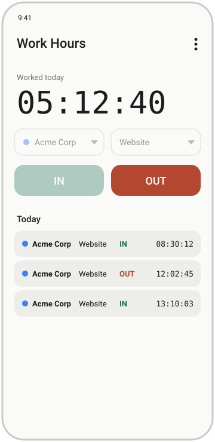
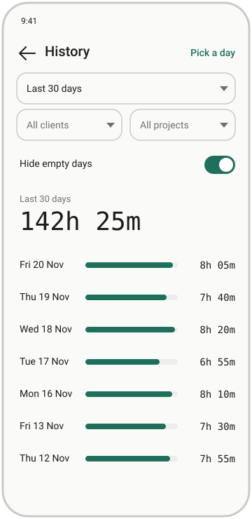
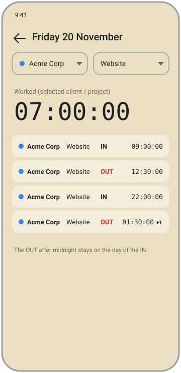
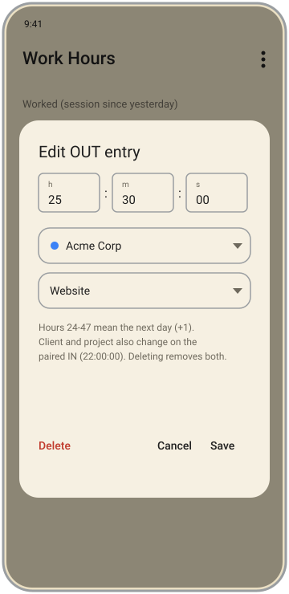
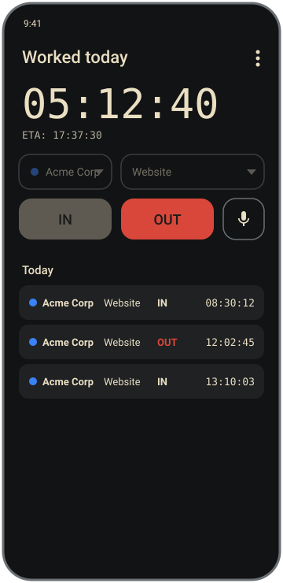

# Work Hours

A simple, minimalist Android app to track your work hours. Press **IN** and **OUT**, pick the client and project you work on, and see your worked time live. Everything is stored locally on the phone.

Built with Kotlin, Jetpack Compose (Material 3) and Room. Requires Android 8.0 (API 26) or newer.

## Screenshots

<table>
  <tr>
    <td align="center"><br><sub>Main screen, clocked in</sub></td>
    <td align="center"><br><sub>History with filters</sub></td>
    <td align="center"><br><sub>Day screen, session through midnight</sub></td>
  </tr>
  <tr>
    <td align="center"><br><sub>Edit an entry</sub></td>
    <td align="center"><br><sub>Settings</sub></td>
    <td align="center"><br><sub>Dark theme</sub></td>
  </tr>
</table>

> The images are illustrations of the screens, not real screenshots. You can replace the files in `docs/images/` with real ones.

## Features

### Main screen
- **Live counter** of today's worked time in `HH:MM:SS`.
- **IN / OUT buttons.** Each press saves an entry with the current time, the label and the day. IN is enabled when you are clocked out, OUT when you are clocked in.
- **Client and project selectors.**
  - Projects belong to a client: only the chosen client's projects are listed.
  - You can create a new client (with a color) or project directly from the dropdowns.
  - Both are required to press IN. OUT automatically uses the client and project of the IN.
  - While clocked in the selectors are grayed out and show the running entry's client and project.
- **Today's entries list** in the order client (with its color), project, IN/OUT, time. Tap an entry to edit or delete it.

### Working through midnight
- An OUT after midnight is saved on the **day of the IN**, with hours 24 and up (01:30 becomes `25:30:00`) and shown as `01:30:00 +1`. One shift stays one IN/OUT pair on one day.
- While such a session is running, the main screen keeps showing it as "since yesterday". An IN left open for more than a day is not counted as running.

### Rounding
Separate settings for the IN button and the OUT button: no rounding, minutes up / down / nearest, 15 minutes up / down, 30 minutes up / down, 1 hour up / down.
- A rounded time is never earlier than the previous entry.
- Rounding never moves an IN into the next day (it stops at 23:59:59).

### Menu (three dots)
- **Dark / light theme** switch. Light is the default and uses the colors of the app icon (beige dial, black, red, steel). Dark is modelled on a black Hanhart dial (matte black with cream details and a red accent). The choice is remembered.
- **History**
- **Export database** as a text file (`id;day;in_out;time;client_id;project_id;client;project`), saved with the system file picker.
- **Settings**

### History
- **Period dropdown:** last 30 days, current week, last week, current month, last month. Weeks start on your locale's first day of the week; "current" periods end today.
- **Filters:** client and/or project (choosing a project also selects its client).
- **Hide empty days** switch.
- **Total hours** for the period, plus one row per day with a bar and the hours worked.
- **Pick a day** from a calendar, or tap a day in the list.

### Day screen
- Worked time of the selected day and its entries.
- **Client / project filter:** the worked time is computed only for the selected client and project, and only their entries are listed. It starts from the History filter.
- Edit and delete entries here too.

### Editing and deleting entries
Available from the main screen and the day screen.
- **Edit:** time (hours, minutes, seconds), client and project. Client and project are applied to both entries of the IN/OUT pair. A new time must stay between the previous and the next entry and can't be in the future. An OUT can use hours 24-47 for the next day.
- **Delete:** removes the entry and its IN/OUT partner.
- **Last entry of today:** it is deleted on its own. Deleting a last **OUT** keeps the IN, so the live counter starts again. Deleting a running **IN** stops the counter and re-enables the selectors and buttons.

### Notification
Optional notification when today's worked time reaches a set amount (hours and minutes).
- Scheduled for the exact moment the running session reaches the target, updated whenever entries or settings change, and restored after a reboot.
- Needs the notification permission (Android 13+). For exact timing, allow exact alarms from the shortcut in Settings, otherwise Android may delay it a few minutes.

### Settings
- **Clients & projects:** add, rename and recolor clients (10-color palette), add and rename projects, delete them. Names are stored by id, so renaming updates all past entries. A client or project that has entries can't be deleted, rename it instead.
- **Notification:** on/off and the target time.
- **Rounding:** for the IN and OUT buttons.
- **History:** default period of the History screen.
- **Data:** delete today's entries, delete all entries.
- **App version** at the bottom.

## Data
A local Room database (`workhours.db`), no account and no sync.

| Table | Columns |
|---|---|
| `entries` | `id`, `day` (yyyy-MM-dd), `in_out` (IN/OUT), `time` (HH:mm:ss, may be 24:00:00 or more for an OUT after midnight), `client_id`, `project_id` |
| `clients` | `id`, `name`, `color` |
| `projects` | `id`, `client_id`, `name` |

Databases from older versions are migrated automatically (old entries keep an empty client and project).

## Build
Open the folder in Android Studio (Ladybug or newer), let Gradle sync, then run. Command line: `gradle assembleRelease` (Gradle 8.10+, JDK 17). Local builds show the version `dev`; the version comes from `-PappVersion=...`.

### GitHub Actions (`.github/workflows/build.yaml`)
- **On push:** builds `WorkHours-<commit hash>.apk` and uploads it as a workflow artifact.
- **On release (published):** builds `WorkHours-<release tag>.apk` and attaches it to the release.
- **Signing (optional):** add the secrets `KEYSTORE_BASE64`, `KEYSTORE_PASSWORD`, `KEY_ALIAS` and `KEY_PASSWORD` to sign with your own key. Without them a temporary debug key is used, and each build has a different key, so updating over an older install needs an uninstall first.

## Permissions
- `POST_NOTIFICATIONS`: the worked-time notification.
- `SCHEDULE_EXACT_ALARM`: exact timing of that notification.
- `RECEIVE_BOOT_COMPLETED`: restore the notification alarm after a reboot.

## Project structure
```
app/src/main/java/com/example/workhours/
  MainActivity.kt        entry point and theme
  MainViewModel.kt       state, entries, filters, settings
  TimeRounding.kt        rounding options
  HistoryPeriod.kt       history periods
  Reminder.kt            notification alarm and receivers
  data/                  Room database, models, time and pairing helpers
  ui/                    screens: main, history, day, settings, clients & projects, entry editor
docs/images/             illustrations used in this README
```
